# Zen — Comprehensive User Guide
## Step-by-Step Operating Manual for Counter Billing, Ledger & Cloud Sync

This guide provides step-by-step instructions for operating **Zen** during daily commercial hours. Every section is written in clear, procedural language (*"click this, do this"*). High-resolution screenshots of each screen are embedded throughout the manual for immediate visual reference.

---

## Table of Contents
1. [System Navigation & Top Bar Controls](#1-system-navigation--top-bar-controls)
2. [Produce Rates & Catalog Management](#2-produce-rates--catalog-management)
3. [Rapid Billing & Counter Sales](#3-rapid-billing--counter-sales)
4. [Customer Khata Ledger Management & Party Deletion](#4-customer-khata-ledger-management--party-deletion)
5. [Receiving Payments & Debt Recoveries](#5-receiving-payments--debt-recoveries)
6. [Daybook (Roznamcha) Audit Register](#6-daybook-roznamcha-audit-register)
7. [Produce Inventory & Spoilage Tracking](#7-produce-inventory--spoilage-tracking)
8. [Executive Business Dashboard](#8-executive-business-dashboard)
9. [Settings & Cloud Synchronization](#9-settings--cloud-synchronization)
   - [9.1 Shop Profile & Thermal Receipt Header](#91-shop-profile--thermal-receipt-header)
   - [9.2 Excel & CSV Data Sync](#92-excel--csv-data-sync)
   - [9.3 Google Sheets Cloud Sync: Upload & Download](#93-google-sheets-cloud-sync-upload--download)
   - [9.4 Daily Shop SOP Checklist](#94-daily-shop-sop-checklist)
   - [9.5 System Resets: Clean Ledger vs 100% Blank Slate](#95-system-resets-clean-ledger-vs-100-blank-slate)
   - [9.6 Owner Security PIN & Counter Role Lock](#96-owner-security-pin--counter-role-lock)
   - [9.7 Mobile Offline Sync Queue & Auto-Flushing](#97-mobile-offline-sync-queue--auto-flushing)
10. [WhatsApp Bill & Statement Dispatch](#10-whatsapp-bill--statement-dispatch)

---

## 1. System Navigation & Top Bar Controls

The top header bar is present on all screens and controls global operations:

```
[Zen]  LOCATION: [Main Mandi Yard v]  DATE: [2026-10-30]   Billing  Dashboard  Inventory  Customers  Daybook  Rates  Settings  Guide   [Synced] [Lock]  [+ Create v]  [हिन्दी]  [Dark]
```

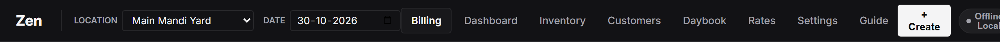

### Steps to Operate Top Header Controls:
1. **Switch Active Counter/Stall:** Click the **LOCATION** dropdown in the top-left to select your active selling platform (e.g., *Main Mandi Yard*, *Wholesale Shed B*). Every bill will automatically tag this location.
2. **Change Operational Date:** Click the **DATE** picker to inspect past trading days, review customer accounts on a previous date, or prepare back-dated bills.
3. **Cloud Sync Status:** Observe the **Sync Pill** (`Synced`, `Local`, `[N] Queued`, `Offline`). Click the pill at any time to inspect queue details or trigger an immediate sync flush.
4. **Owner Lock / Cashier Toggle:** Click the **Lock Button** to toggle between **Cashier Mode** and **Owner (Unlocked)**. When stepping away from the counter, 1-click lock immediately protects sensitive functions (resets, deletions, cloud config).
5. **Quick Action Menu:** Click the **+ Create** button in the top-right to quickly open shortcuts:
   * *New Bill*
   * *Receive Payment*
   * *New Customer*
   * *New Produce Item*
   * *New Location*
6. **Change Language:** Click **हिन्दी** to instantly switch the interface to Hindi, or click **English** to return to English.
7. **Switch Display Mode:** Click the **Theme** button to toggle between high-contrast **Dark Mode** (optimized for early morning auctions) and **Light Mode** (for daytime office work).

---

## 2. Produce Rates & Catalog Management

Before trading starts, set your daily wholesale prices in the **Rates** tab (`items.html`).

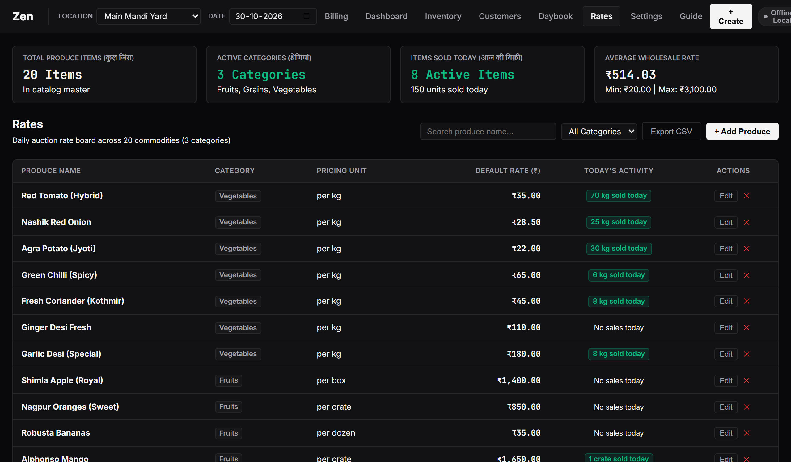

### How to Update Daily Produce Prices:
1. Click **Rates** in the top navigation bar.
2. Locate the commodity you want to update (e.g., *Red Tomato*, *Nashik Onion*). Use the category tabs (*Vegetables*, *Fruits*, *Grains*) or the search bar to locate items quickly.
3. Click the **Edit Rate** button next to the item.
4. Type the new wholesale rate per kilogram, crate, or bag (e.g., `38.50`).
5. Click **Save Rate**. The new rate is now active on all new billing dockets immediately.

### How to Add a New Produce Commodity:
1. On the **Rates** screen (or via the **+ Create** button in the top header), click **+ Add Produce Item**.
2. Enter the **Produce Name** (e.g., *Nagpur Orange (Grade A)*).
3. Select the **Category** (*Vegetables*, *Fruits*, or *Grains*).
4. Select the standard **Unit** (`kg`, `crate`, `box`, `bag`, or `qtl`).
5. Enter the standard **Wholesale Rate** in rupees.
6. Click **Save Commodity**. The item will immediately appear on the billing screen.

---

## 3. Rapid Billing & Counter Sales

The **Billing** screen (`index.html`) is where produce is weighed, priced, and invoiced during trading hours.

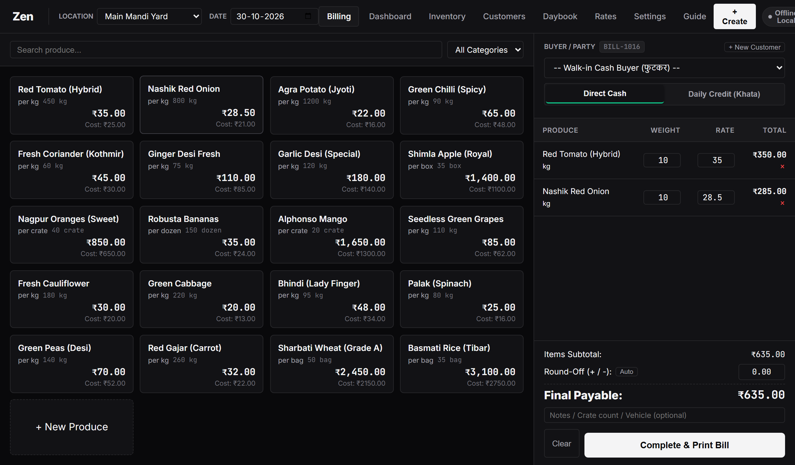

### Step 3.1: Direct Cash Sale (Walk-in Buyer)
1. Click **Billing** in the top navigation.
2. Ensure the payment toggle is set to **Direct Cash** (active by default).
3. Click on a produce item from the catalog on the left (e.g., *Nashik Red Onion*).
4. The item appears in the **Active Bill Docket** on the right.
5. Type the weight or quantity (e.g., `45` kg). The line total calculates automatically.
6. Repeat for any additional produce items the buyer is taking.
7. If bargaining involves rounding down the amount, enter the adjustment in the **Round-Off** input (e.g., `-20.00`).
8. Click the large green button: **Complete & Print Bill**.
9. The 80mm thermal receipt preview appears:
   * **Print Thermal Slip:** Click **Print Receipt** to print directly to your 80mm thermal roll printer.
   * **Share on WhatsApp:** Click **Share WhatsApp** to instantly dispatch the itemized bill to the buyer's phone via WhatsApp.
10. Click **Close** (or press Escape) to return to the active docket for the next customer.

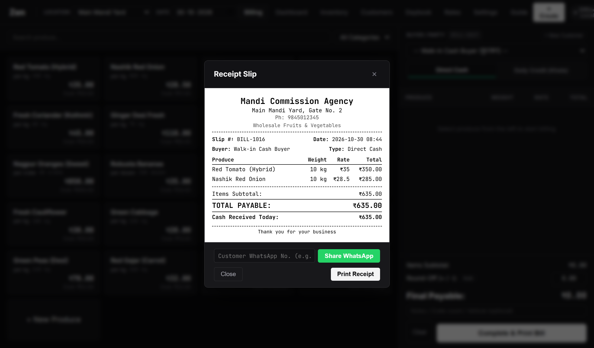

---

### Step 3.2: Daily Credit (Khata) Sale (Registered Buyer)
1. On the **Billing** screen, click the **Daily Credit (Khata)** toggle button.
2. A customer selection dropdown will appear on the docket.
3. Select the buyer's name (e.g., *Ramesh Sabzi Bhandar*).
4. **Inspect the Risk Banner:** An alert box immediately appears above the bill showing the buyer's financial standing:
   * **Past Overdue:** Carryover debt from previous days.
   * **Today's Credit:** Goods already taken today.
   * **Total Outstanding:** Net debt exposure.
5. Add the produce items, weights, and rates as usual.
6. Click **Complete & Print Bill**.
7. The bill is recorded under the customer's ledger, and their pending balance increases automatically.

---

## 4. Customer Khata Ledger Management & Party Deletion

The **Customers** screen (`customers.html`) provides a complete ledger (*Khata Dossier*) for all commercial accounts.

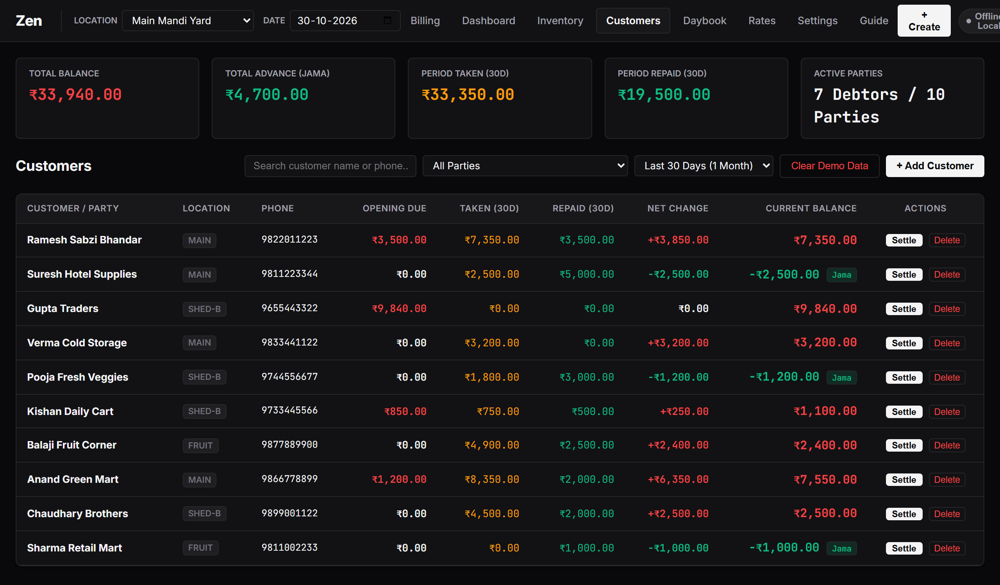

### How to Add a New Customer / Buyer:
1. Click **Customers** in the navigation bar.
2. Click the **+ Add Customer** button at the top-right.
3. Enter the **Party Name** (e.g., *Kishan Daily Cart*).
4. Enter their **Phone Number** (e.g., `9845012345`).
5. Select their primary **Default Stall**.
6. Enter their **Opening Past Due (₹)** if they have an existing balance from an old register. If they start clean, leave it as `0.00`.
7. Click **Save Customer**.

### How to View a Customer's Ledger Statement:
1. In the customer list, locate the party using the search bar or filter pills.
2. Click on the customer card to open their **Ledger Statement Dossier**.
3. View their complete chronological ledger breakdown:
   * Opening Past Due
   * Taken (bills issued during the period)
   * Repaid (cash and online payments received)
   * Running Net Balance
4. To print or export an official statement, click **Print Statement** or **Share WhatsApp**.

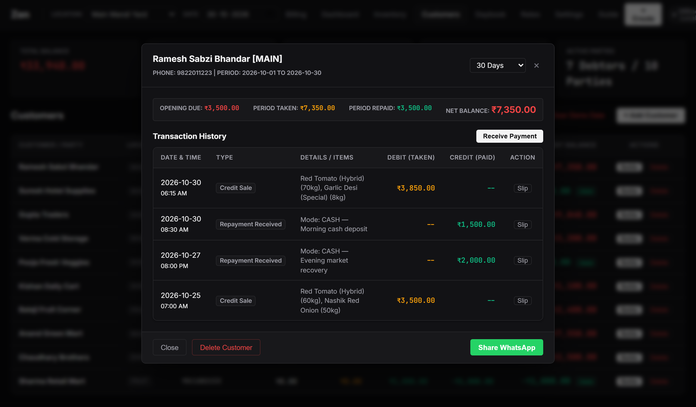

### How to Delete a Customer:
1. On any customer row, click the **Delete** button on the far right (or open their statement modal and click **Delete Customer**).
2. **Zero-Balance Party:** If the customer has zero balance and zero active bills, they are deleted immediately without requiring a PIN.
3. **Party with Active Balance:** If the customer owes money or has an active balance, Zen requires the **Owner Security PIN** to confirm deletion.
4. Once deleted, the party is removed permanently from device storage and will never be re-injected on page reload.

### How to Clear Demo Customers:
* Click the red **Clear Demo Data** button in the Customers toolbar.
* It safely removes all sample demo customers while keeping any real parties you entered manually.

---

## 5. Receiving Payments & Debt Recoveries

When a credit buyer settles dues, record the recovery using the **Receive Payment** feature.

### Steps to Record a Payment:
1. Click **+ Create** in the top header and choose **Receive Payment** (or click **Receive Payment** inside a customer's statement modal).
2. Select the **Customer / Party Name**.
3. The customer's current total pending debt is displayed automatically.
4. Enter the **Payment Amount Received (₹)** (e.g., `5000.00`).
5. Select the **Payment Mode**:
   * **CASH:** Adds to physical cash in register.
   * **UPI / GPay:** Marks as bank transfer.
   * **Bank NEFT / Cheque:** Records bank settlement.
6. Optional: Enter a short memo in **Notes** (e.g., *"Evening collection via UPI"*).
7. Click **Save Payment Receipt**.
8. The customer's debt is reduced instantly, and a repayment entry is recorded in the Daybook.

---

## 6. Daybook (Roznamcha) Audit Register

The **Daybook** screen (`daybook.html`) serves as your daily financial audit log.

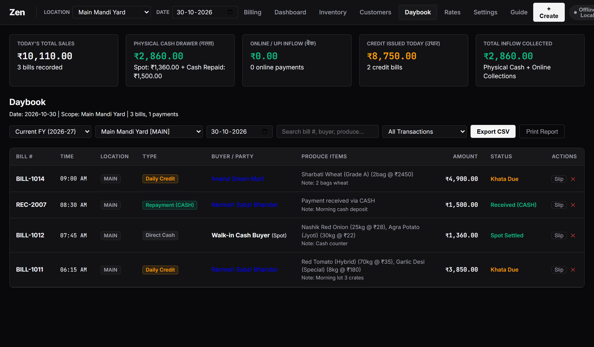

### Steps to Audit Daily Operations:
1. Click **Daybook** in the top navigation.
2. Check the top summary metrics:
   * **Direct Spot Cash:** Cash collected immediately from walk-in cash bills.
   * **Khata Debt Recoveries:** Cash collected from debtors paying off past accounts.
   * **Digital Inflow (UPI):** Bank transfers and QR code payments.
   * **Physical Cash In Register:** The exact amount of currency notes that must be in your counter drawer:
     ```
     Total Drawer Cash = Direct Spot Cash + Repayment Cash Inflow
     ```
3. Scroll through the chronological transaction table.
4. **How to Cancel a Mistaken Bill:**
   * Locate the bill in the table and click **Cancel**.
   * Enter the Owner PIN if prompted. The bill is moved to the Recycle Bin and customer balances adjust automatically.
5. **How to Export Today's Audit:**
   * Click **Export CSV** at the top-right to download an Excel-compatible spreadsheet of the day's register.

---

## 7. Produce Inventory & Spoilage Tracking

Zen includes complete inventory tracking for wholesale arrivals, floor stock, and spoilage losses (`inventory.html`).

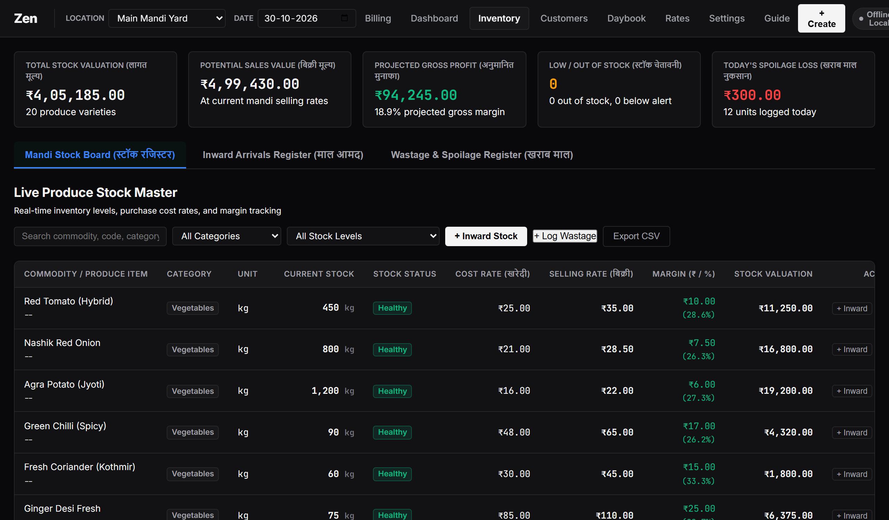

### 7.1 Recording Inward Stock Arrivals (Aamad / Purchase)
1. Click **+ Inward Stock** in the Inventory tab.
2. Select the produce item, inward quantity (e.g. `500 kg`), and purchase cost price per unit.
3. Enter the truck vehicle number, supplier source, and challan notes.
4. Current stock and valuation update immediately.

### 7.2 Logging Spoilage & Wastage (Kharab / Loss)
1. Perishable goods damaged in transit or wilted must be written off to keep accounting accurate.
2. Click **+ Log Wastage** on the Inventory screen.
3. Select the commodity, enter damaged quantity, and choose the write-off reason (*Overripe / Rotten*, *Transit Bruising*, *Moisture Damage*).
4. The system deducts the units from active stock and records the loss on your Executive Dashboard.

---

## 8. Executive Business Dashboard

The **Dashboard** screen (`dashboard.html`) provides executive analytics and risk metrics.

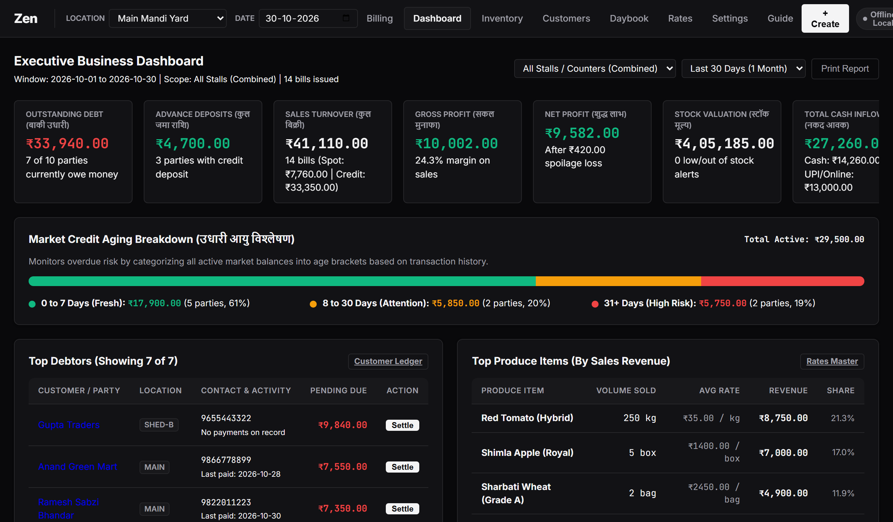

### Key Metrics Tracked:
1. **Outstanding Debt:** Total market balance owed across all registered customers.
2. **Advance Deposits (Jama):** Excess payments deposited by parties available for future drawing.
3. **Sales Turnover:** Gross sales volume across all spot cash and credit bills.
4. **Gross & Net Profit:** Real-time profit calculated by subtracting cost of goods sold and spoilage losses from sales revenue.
5. **Stock Valuation:** Total value of inventory sitting in your shop at cost price.
6. **Debt Aging Watchlist:** Overdue debts categorized into 0-7 days (Fresh), 8-15 days (Warning), 16-30 days (High Risk), and 30+ days (Critical).

---

## 9. Settings & Cloud Synchronization

The **Settings** screen (`settings.html`) manages firm configuration, cloud connections, and backups.

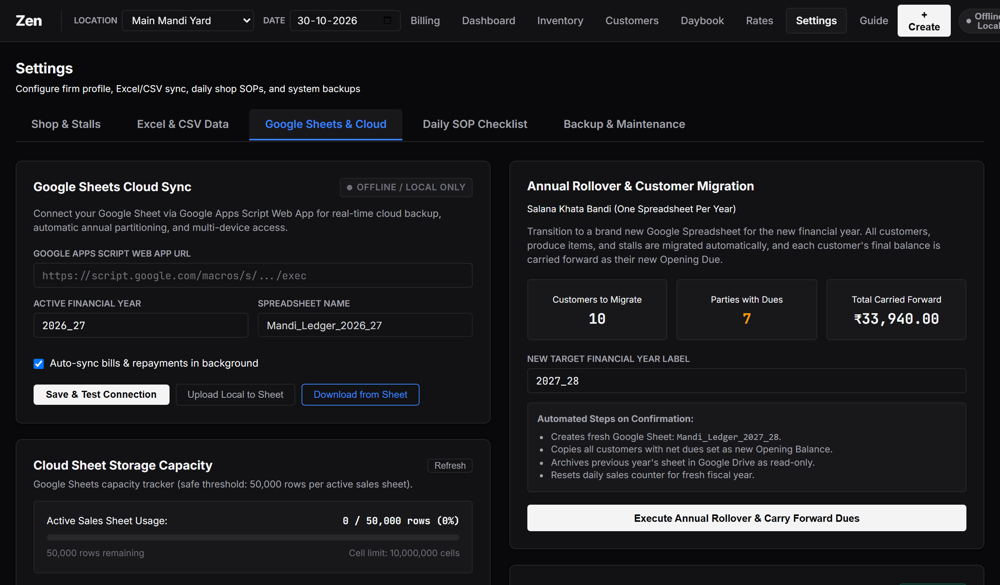

### 9.1 Shop Profile & Thermal Receipt Header
1. Click **Settings** -> **Shop & Stalls** tab.
2. Enter your **Shop / Firm Name**, **Tagline**, **Address**, and **Phone Number**.
3. Inspect the live receipt preview on the right and click **Save Shop Profile**.

### 9.2 Excel & CSV Data Sync
* **Exporting:** Download complete CSV files for customers, produce rates, and sales registers. All files use UTF-8 BOM encoding for seamless Microsoft Excel compatibility.
* **Importing:** Bulk upload customer contacts and produce catalogs using standard CSV templates.

### 9.3 Google Sheets Cloud Sync: Upload & Download
Connect your database to Google Sheets for multi-device sync and automatic annual archiving:

#### Setting Up Google Sheets Connection:
1. Open your spreadsheet in Google Sheets (e.g. `test-table` or `sheets.new`).
2. Go to **Extensions -> Apps Script**.
3. Paste the complete code from `google_sheets_sync.js` into the script editor.
4. Click **Deploy -> New deployment -> Web app**. Set *Execute as: Me* and *Who has access: Anyone*.
5. Copy the generated Web App URL (`https://script.google.com/macros/s/.../exec`).
6. In Zen **Settings -> Google Sheets & Cloud**, paste the URL into **Google Apps Script Web App URL**.
7. Click **Save & Test Connection**. The status turns green (**Connected & Synced**).

#### Two-Way Data Sync Controls:
* **Upload Local to Sheet:** Takes your local browser records (customers, rates, inventory) and overwrites the Google Sheets database. If your local store is empty, it warns you before clearing the sheet.
* **Download from Sheet:** Downloads all records from your Google Sheet (Customers, Rates, Inventory, Settings) and hydrates your local browser storage.

#### 1-Click Annual Rollover (Salana Khata Bandi):
* At the close of the financial year (March 31), enter the new year label (e.g. `2027_28`) and click **Execute Annual Rollover & Carry Forward Dues**.
* The script creates a fresh spreadsheet in your Google Drive, carries forward customer closing balances as new Opening Dues, copies produce rates, and archives the previous year.

---

### 9.5 System Resets: Clean Ledger vs 100% Blank Slate

In **Settings -> Backup & Maintenance**, you have three reset options:

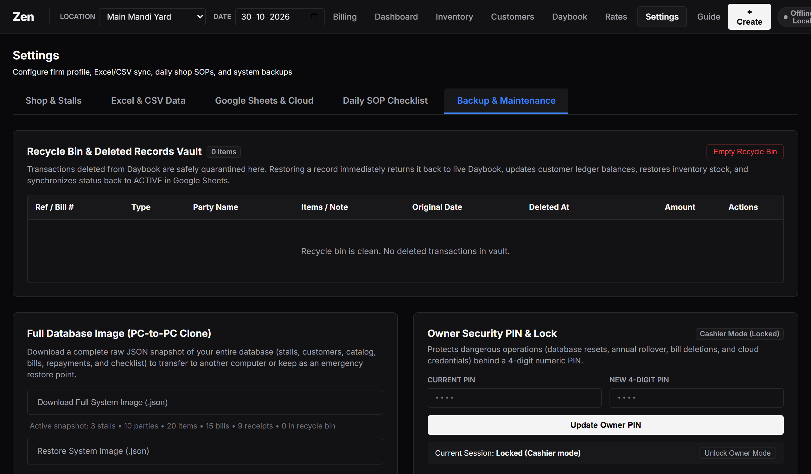

1. **Reset to Clean Produce Ledger:**
   * Keeps standard produce items and wholesale rates.
   * Wipes all customers (`customers: []`).
   * Wipes active sales and payments (`sales: []`, `payments: []`).
   * Wipes previous year archives (`archivedYears: []`) and inventory inward/wastage records.
2. **Wipe to 100% Blank Slate:**
   * Wipes absolutely everything to 0 (`items: []`, `inventory: []`, `customers: []`, `sales: []`, `archivedYears: []`).
   * Leaves a 100% blank canvas for any commercial agency or service to start fresh or download from Google Sheets.
3. **Load Complete Mandi Test Dataset:**
   * Seeds 20 produce commodities, 10 parties with multi-day credit aging, and previous year historical archives for practice.

---

### 9.6 Owner Security PIN & Counter Role Lock
* **Default PIN:** `1234`.
* **Updating PIN:** Navigate to **Settings -> Backup & Maintenance -> Owner Security PIN** to update your 4-digit code.
* **Protected Operations:** Demanded whenever attempting to delete customers with balances, execute database wipes, or modify cloud configurations.

### 9.7 Mobile Offline Sync Queue & Auto-Flushing
* **100% Offline Capability:** In areas with spotty internet, Zen writes all transactions locally and buffers them in `syncQueue`.
* **Automatic Upload:** As soon as Wi-Fi or cellular connection is restored, Zen pushes queued transactions to Google Sheets in the background.

---

## 10. WhatsApp Bill & Statement Dispatch

Zen features direct WhatsApp integration that operates without third-party API keys or subscription fees:

1. **Sales Bill Dispatch:** After finalizing a bill, click **Share WhatsApp**. On desktop it launches `web.whatsapp.com`, and on mobile it launches the native WhatsApp app with the itemized bill pre-typed.
2. **Payment Receipt Dispatch:** In the payment collection modal, click **Share WhatsApp** to send a formal repayment voucher displaying amount collected and updated balance.
3. **Customer Statement Dispatch:** In the customer statement modal, click **Share WhatsApp** to send a comprehensive balance summary showing Opening Due, Period Taken, Period Repaid, and Net Outstanding Balance.
